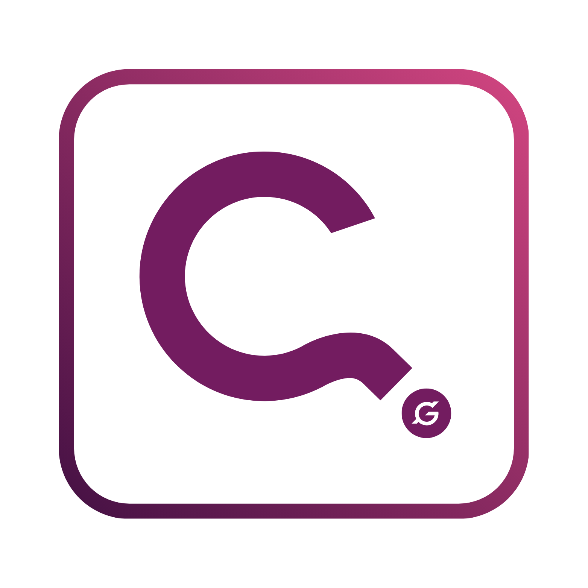

# ESI L1 – Education for Social Impact Level 1

> **Learn Crypto. Earn Crypto. Risk Nothing.**

ESI L1 is a free, beginner-friendly cryptocurrency education program that teaches blockchain fundamentals through hands-on learning. Participants earn real tokens while learning—no investment required.



---

## 🎯 What is ESI L1?

ESI L1 (Education for Social Impact Level 1) is a structured 5-module program designed to introduce complete beginners to the world of cryptocurrency and blockchain technology. Unlike traditional courses, ESI L1 lets you **earn real cryptocurrency** as you progress through the modules.

### Key Features

- **100% Free** – No fees, no hidden costs, no investment required
- **Earn While Learning** – Claim daily Universal Basic Income (UBI) tokens through GoodDollar
- **Hands-On Experience** – Set up real wallets (MiniPay, MetaMask) and make actual transactions
- **Beginner-Friendly** – No prior crypto knowledge needed
- **Self-Paced** – Complete modules at your own speed

---

## 📚 The 5 Modules

| Module | Title | What You'll Learn |
|--------|-------|-------------------|
| 1 | **What is Cryptocurrency?** | Core concepts of digital money, blockchain basics, and why crypto matters |
| 2 | **Setting Up Your First Wallet** | Create and secure a MiniPay wallet, understand public/private keys |
| 3 | **Introduction to GoodDollar** | Learn about UBI, claim daily G$ tokens, explore social impact crypto |
| 4 | **Making Your First Transaction** | Send and receive crypto, read transaction history, understand gas fees |
| 5 | **Exploring the Ecosystem** | Discover DeFi basics, token swaps, and next steps in your crypto journey |

---

## 🌟 Program Outcomes

By completing ESI L1, participants will:

- ✅ Own a secure cryptocurrency wallet
- ✅ Understand blockchain fundamentals
- ✅ Have earned real cryptocurrency (G$ tokens)
- ✅ Know how to send, receive, and track transactions
- ✅ Be prepared for advanced crypto education

---

## 🛠 Technology Stack

This landing page is built with modern web technologies:

| Technology | Purpose |
|------------|---------|
| **React 18** | UI component library |
| **TypeScript** | Type-safe JavaScript |
| **Vite** | Fast build tool and dev server |
| **Tailwind CSS** | Utility-first CSS framework |
| **shadcn/ui** | Accessible UI component library |
| **React Router** | Client-side routing |
| **React Helmet Async** | SEO and meta tag management |
| **Lucide React** | Modern icon library |

---

## 📁 Project Structure

```
src/
├── assets/              # Images and static assets
│   ├── esi-logo.png
│   ├── gooddollar-logo.png
│   ├── minipay-logo.png
│   └── canvassing-logo.png
├── components/          # React components
│   ├── ui/              # shadcn/ui components
│   ├── Header.tsx       # Navigation header
│   ├── HeroSection.tsx  # Landing hero section
│   ├── ProblemSection.tsx
│   ├── ModulesSection.tsx
│   ├── OutcomesSection.tsx
│   ├── WhyDifferentSection.tsx
│   ├── HowItWorksSection.tsx
│   ├── FAQSection.tsx
│   ├── CTASection.tsx
│   └── Footer.tsx
├── pages/               # Page components
│   ├── Index.tsx        # Main landing page
│   ├── PrivacyPolicy.tsx
│   ├── TermsOfService.tsx
│   └── NotFound.tsx
├── hooks/               # Custom React hooks
├── lib/                 # Utility functions
├── index.css            # Global styles and design tokens
├── App.tsx              # Main app component with routing
└── main.tsx             # Application entry point
```

---

## 🚀 Getting Started

### Prerequisites

- Node.js 18+ installed ([install with nvm](https://github.com/nvm-sh/nvm#installing-and-updating))
- npm or bun package manager

### Installation

```bash
# Clone the repository
git clone <YOUR_GIT_URL>

# Navigate to project directory
cd <YOUR_PROJECT_NAME>

# Install dependencies
npm install
# or
bun install

# Start development server
npm run dev
# or
bun dev
```

The app will be available at `http://localhost:5173`

### Build for Production

```bash
npm run build
# or
bun run build
```

---

## 🎨 Design System

The project uses a custom design system with CSS variables for theming:

### Color Palette

- **Primary**: Teal/Green gradient for main CTAs and highlights
- **Accent**: Golden yellow for emphasis and badges
- **Background**: Light neutral with subtle gradients
- **Foreground**: Dark text for readability

### Typography

- **Display Font**: Space Mono (monospace for crypto aesthetic)
- **Body Font**: System fonts for readability

### Key Design Tokens

```css
--primary: 168 84% 40%      /* Teal */
--accent: 45 93% 58%         /* Golden */
--background: 150 20% 98%    /* Light neutral */
--gradient-hero               /* Primary gradient */
--gradient-warm               /* Accent gradient */
```

---

## 📱 Responsive Design

The landing page is fully responsive across all device sizes:

- **Mobile**: Single-column layout, touch-friendly buttons
- **Tablet**: Adaptive grid layouts
- **Desktop**: Full multi-column layouts with enhanced visuals

---

## 🔗 External Integrations

### Partner Platforms

- **[GoodDollar](https://gooddollar.org)** – Universal Basic Income cryptocurrency
- **[MiniPay](https://minipay.to)** – Mobile-first crypto wallet by Opera

### Social Media

- Instagram: [@thecanvassing](https://instagram.com/thecanvassing)
- TikTok: [@thecanvassing](https://tiktok.com/@thecanvassing)
- X (Twitter): [@thecanvassing](https://x.com/thecanvassing)

---

## 📄 Pages

| Route | Description |
|-------|-------------|
| `/` | Main landing page with all sections |
| `/privacy-policy` | Privacy policy document |
| `/terms-of-service` | Terms of service document |

---

## 🤝 About CNV Labs KO XYZ

ESI L1 is developed by **CNV Labs KO XYZ** (formerly Canvassing), an organization focused on blockchain education and financial inclusion. The program is inspired by the belief that everyone deserves access to financial education and the emerging digital economy.

**Contact**: admin@thecanvassing.xyz

---

## 📜 License

This project is proprietary to CNV Labs KO XYZ. All rights reserved.

---

## 🔧 Development

### Using Lovable

Visit the [Lovable Project](https://lovable.dev/projects/29f4ea97-4391-4531-b0b1-e828235783ff) to edit with AI assistance. Changes are automatically committed to the repository.

### Using Your IDE

Clone the repo and push changes. All changes sync bidirectionally with Lovable.

### Deployment

Click **Share → Publish** in Lovable, or deploy the built files to any static hosting service (Vercel, Netlify, Cloudflare Pages, etc.).

### Custom Domain

Navigate to **Project > Settings > Domains** in Lovable to connect your domain. [Learn more](https://docs.lovable.dev/features/custom-domain#custom-domain)
